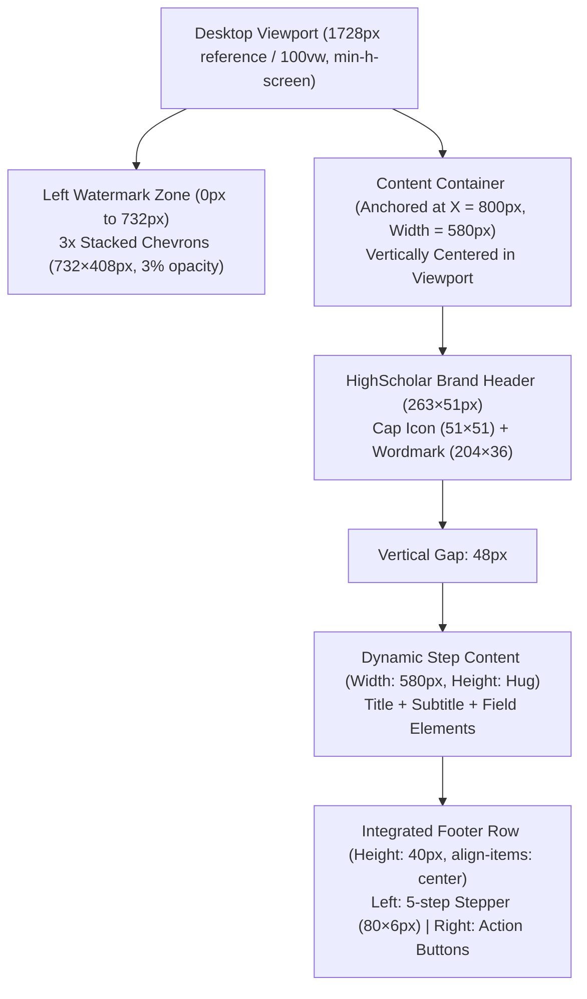

# HighScholar Onboarding Flow: Development Plan

> **Figma Reference**: [Node 161:2348 (Section: Onboarding)](https://www.figma.com/design/zLYU2tCsLDvZNnUXk7Cpgw/HighScholar?node-id=161-2348&m=dev)  
> **Target Canvas**: `1728px × 883px` desktop canvas with responsive breakpoints  
> **Form Specifications**: Width `580px`, Left Anchor `X = 800px`, Gap between Logo & Title `48px`

---

## 1. Architecture & Layout Blueprint

### 1.1 Structural Layout Model

---

## 2. Phase-by-Phase Implementation Plan

### Phase 1: Visual Foundation & Asset Calibration
- [x] **Chevron Watermark Layer**:
  - Verify [`public/onboarding-chevron.svg`](file:///Users/rahat/HighScholar/public/onboarding-chevron.svg) renders with exact `#7050E6` fill and `0.03` (3%) opacity.
  - Position on the left edge (`x: 0` to `x: 732px`), tiled seamlessly 3 times (`y: -123px`, `285px`, `693px`) with `pointer-events-none`.
- [x] **Official Logo Header**:
  - Ensure [`public/onboarding-logo.svg`](file:///Users/rahat/HighScholar/public/onboarding-logo.svg) is horizontal (`263px × 51px`).
  - Left-align with the form container (`x = 800px` on desktop) with a strict `48px` vertical gap to the screen title.

---

### Phase 2: Core Container & Positioning Engine
- [x] **Coordinate Precision**:
  - Set container width strictly to `580px` (`max-w-[580px] w-full`).
  - Desktop positioning: Anchor at `X = 800px` within the 1728px design grid (or `calc((100vw - 1728px)/2 + 800px)` for wide screens).
  - Vertical alignment: Centered vertically within the viewport (`min-h-screen flex items-center`).
- [x] **Unified Footer Row (`Frame 2147226820`)**:
  - Single horizontal row with `height: 40px` and `justify-between` / `items-center`:
    - **Left**: 5-step Stepper (`80px × 6px`).
      - Inactive dots: `8px × 6px`, `rounded-full`, `#EDE9FC`.
      - Active pill: `32px × 6px`, `rounded-full`, `#704FE5` / `#7150E7`.
      - Gap between dots: `4px`.
    - **Right**: Action buttons (`< Previous` and `Next Step >` / `Complete Profile...`).

---

### Phase 3: Screen-by-Screen Component Construction

#### Step 1: Personal Identity & Contact (`580 × 431 Hug`)
- **Title**: *"Let’s begin with your scholar profile"* (`24px`, semibold `#000000`).
- **Subtitle**: *"Enter your name and contact details to register your application dashboard."* (`14px`, `#919EAB`).
- **Floating Notched Inputs**:
  - `Full Name` and `Email` input boxes (`h: 48px`, border `1px solid #E1E8F0`, rounded `8px`).
  - Floating top-border notched label (`11px` italic `#62748E`, with white background badge).
- **Subtext**: *"Used for deadline alerts and application tracking summaries."* (`12px`, `#62748E`).
- **Footer**:
  - Left: Stepper dot 1 active (`32px` pill).
  - Right: `Next Step >` button (`160.8px × 40px`, rounded `20px`, solid `#704FE5`, white text + chevron).

#### Step 2: Target Academic Degree (`580 × 497 Hug`)
- **Title**: *"Which academic degree are you targeting?"*
- **Subtitle**: *"Selecting Master’s or PhD activates the Professor & Research Lab matching engine."*
- **3 Degree Cards** (`580px × 76px`, rounded `8px`):
  1. *Bachelor’s Degree* — "Undergraduate study, fully funded merit & entrance awards"
  2. *Master’s Degree* — "Coursework & research MS, departmental assistantships & fellowships"
  3. *Doctoral / PhD* — "Research labs, advisor funding, fully funded RA/TA positions"
- **States**: Selected card receives `1px solid #704FE5` border, purple heading, and trailing checkmark `✓`.
- **Footer**:
  - Left: Stepper dot 2 active.
  - Right: `< Previous` (`104px × 40px`, outline `#704FE5`) and `Next Step >` (`160.8px × 40px`).

#### Step 3: Fields of Research & Study (`580 × 651 Hug`)
- **Title**: *"What are your primary fields of research & study?"*
- **Subtitle**: *"Select your major and sub-specialisations to calculate match scores."*
- **Tag Cloud**:
  - 19+ specialization pills from Figma (Computer Science, AI & ML, Robotics, HCI & UX, etc.) + extensible "Other +" pill.
  - Selected: solid `#704FE5` background, white text, checkmark `✓`.
  - Unselected: `#F3F3F3` background, `#314158` text, plus icon `+`.
- **Selected Counter**: *"Selected {count} specializations. We will compute match scores based on these tags."*
- **Footer**:
  - Left: Stepper dot 3 active.
  - Right: `< Previous` and `Next Step >`.

#### Step 4: Target Study Destinations (`580 × 550.92 Hug`)
- **Title**: *"Where in the world do you want to study?"*
- **Subtitle**: *"Choose countries matching your visa, stipend, and lifestyle preferences."*
- **4-Column Grid** (16 country cards + Other):
  - Card dimensions: `137.5px × 46px`, rounded `8px`.
  - Countries: USA, UK, Germany, Canada, Sweden, France, Switzerland, Japan, South Korea, Singapore, Australia, Ireland, Italy, Turkey, Netherlands, New Zealand.
  - Flag emoji (16px) + Country name (12px). Selected gets `#704FE5` border and checkmark.
- **Footer**:
  - Left: Stepper dot 4 active.
  - Right: `< Previous` and `Next Step >`.

#### Step 5: Academic Background & Test Scores (`580 × 514.92 Hug`)
- **Title**: *"Academic Background & Test Scores"*
- **Subtitle**: *"These scores verify eligibility cut-offs (e.g. minimum CGPA, IELTS, GRE)."*
- **3 Metric Cards** (`183px × 142px` each):
  1. *Normalized CGPA (4.0 scale)* — number input, helper: "e.g., 3.85 / 4.00"
  2. *English Band (IELTS / TOEFL)* — number input, helper: "e.g., 7.5 or 8.0"
  3. *GRE / GMAT Total* — number input with active focus `#704FE5`, helper: "e.g., 324 (Quant 168)"
- **Amber Warning / Cut-off Notice**:
  - `#FFFBEB` background, `#FDE68A` border, `rounded-xl`, `HelpCircle` icon, text `#7B3306`.
- **Footer**:
  - Left: Stepper dot 5 active.
  - Right: `< Previous` (`104px`) and `Complete Profile & Reveal Matches >` (`259px × 40px`, solid `#704FE5`).

---

### Phase 4: State Management & Application Integration
- [x] **Context Sync**:
  - Integrate with `AppContext` (`profile`, `updateProfile`).
  - Save `onboardingCompleted: true` and persist to `localStorage`.
- [x] **Entry Points**:
  - Dedicated route: [`/onboarding`](file:///Users/rahat/HighScholar/src/app/onboarding/page.tsx).
  - Modal overlay in dashboard: [`src/components/OnboardingModal.tsx`](file:///Users/rahat/HighScholar/src/components/OnboardingModal.tsx) for first-time login/signup triggers.

---

### Phase 5: Verification & Quality Assurance
- [x] Verify exact coordinate matching on desktop (`X=800`, `W=580`, `Gap=48`).
- [x] Test mobile & tablet responsiveness (graceful downscaling to single-column centered).
- [x] Run `npm run build` to confirm zero TypeScript and Next.js compilation issues.
