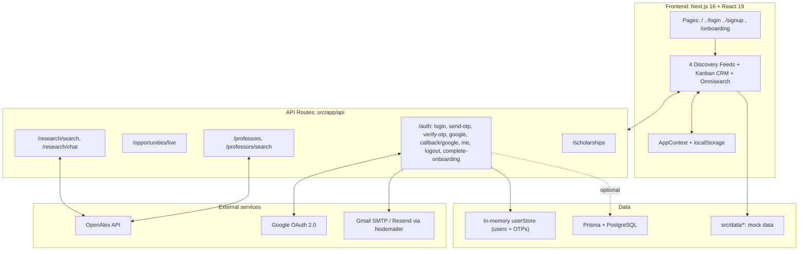
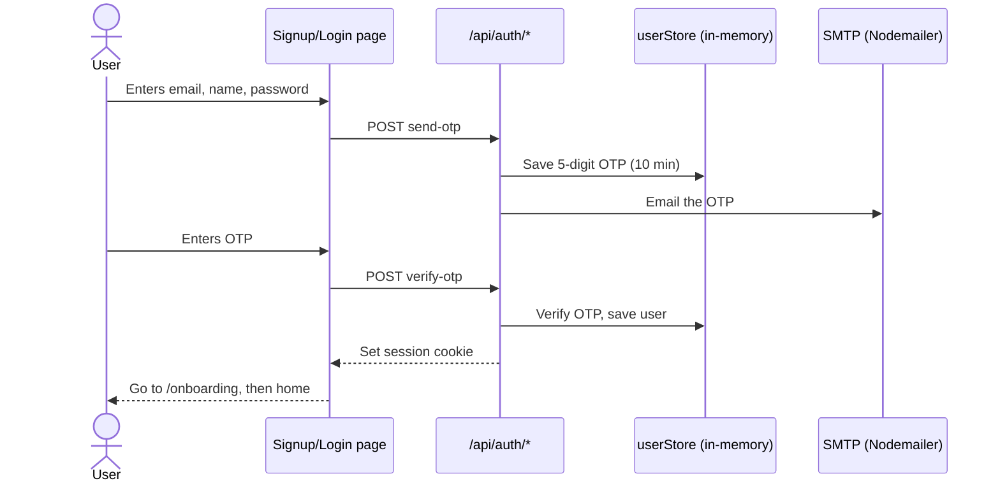
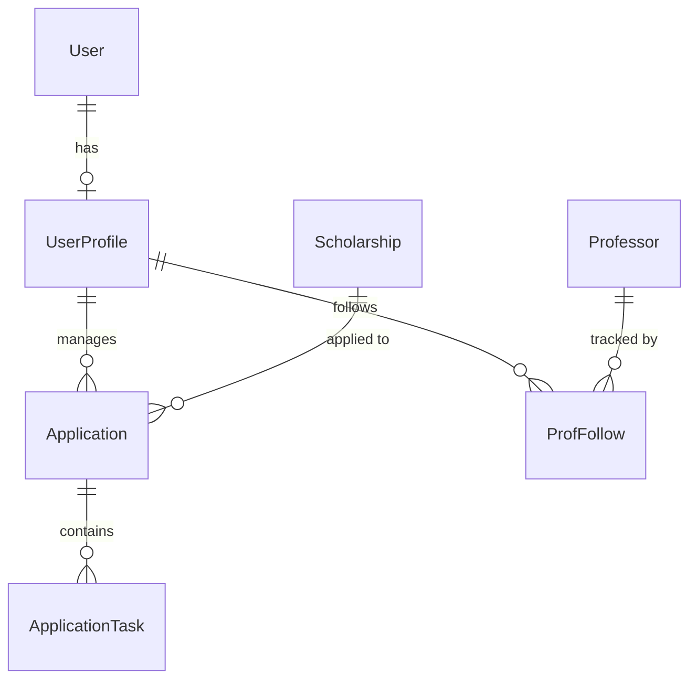

# Scholars' Ship: Architecture / আর্কিটেকচার

> আগের নাম / Former name: **HighScholar**. কোড ও এনভায়রনমেন্টে এখনো কিছু জায়গায় পুরোনো নাম আছে (যেমন `highscholar_session`)।
> Some code and env still use the old name (e.g. `highscholar_session`).
>
> এই ডক মূল ডকুমেন্ট (`HighScholar_Full_Project_Documentation.md`) এবং **আসল কোড** মিলিয়ে বানানো। অমিল থাকলে কোডকে সত্য ধরা হয়েছে।
> Built from the original document plus the **actual code**. Where they differ, the code is treated as truth. (Checked: 2026-10-01)

---

## 1. Product / প্রোডাক্ট

| | |
|---|---|
| **বাংলা** | গ্রাজুয়েট (Masters/PhD) আবেদনকারীদের জন্য AI-চালিত স্কলারশিপ, রিসার্চ ল্যাব ও পেপার ডিসকভারি পোর্টাল। স্কলারশিপ, প্রফেসর, অ্যাসিস্ট্যান্টশিপ ও পেপার এক জায়গায় পাওয়া যায়। |
| **English** | An AI-powered discovery portal for graduate applicants: scholarships, professors/labs, assistantships and papers in one place. |

**মূল ফিচার / Core features**
1. **4 Discovery Feeds:** Opportunity Feed, Scholarship Radar, Faculty & Labs, Research Papers
2. **Smart Matching:** GPA, IELTS/TOEFL/GRE ও আগ্রহ অনুযায়ী মিল / match by GPA, test scores, interests
3. **Application CRM:** দুই ধরনের Kanban (আবেদন ও প্রফেসর আউটরিচ) / two Kanban boards (applications and outreach)
4. **Global Omnisearch:** এক সার্চে সব / one search across everything
5. **Onboarding (৫ ধাপ / 5 steps):** ব্যক্তিগত তথ্য, ডিগ্রি, রিসার্চ ক্ষেত্র, দেশ, একাডেমিক ব্যাকগ্রাউন্ড। বিস্তারিত: [ONBOARDING_PLAN.md](../ONBOARDING_PLAN.md)

---

## 2. System Architecture / সিস্টেম আর্কিটেকচার

**বাংলা:** UI `src/app/` ও `src/components/`-এ। সার্ভার কোড `src/app/api/`-তে। সাহায্যকারী কোড `src/lib/`-এ (`auth.ts`, `email.ts`, `userStore.ts`, `prisma.ts`, `semanticSearch.ts`)।
**English:** UI lives in `src/app/` and `src/components/`, server code in `src/app/api/`, helpers in `src/lib/`.

---

## 3. Authentication Flow / লগইন প্রবাহ

বিকল্প / Alternatives: পাসওয়ার্ড লগইন (`/api/auth/login`) এবং Google OAuth (`/api/auth/google` → `/api/auth/callback/google`)।

---

## 4. Data Model / ডেটা মডেল

`prisma/schema.prisma` (PostgreSQL): `User`, `UserProfile`, `Scholarship`, `Professor`, `ProfFollow`, `Application`, `ApplicationTask` এবং enum `DegreeLevel`, `ApplicationStatus`, `DecisionResult`।

---

## 5. API Endpoints / এন্ডপয়েন্ট

| Endpoint | কাজ / Purpose |
|---|---|
| `/api/auth/send-otp`, `verify-otp` | ইমেইল OTP পাঠানো ও যাচাই / send and verify email OTP |
| `/api/auth/login`, `logout`, `me` | পাসওয়ার্ড লগইন, লগআউট, বর্তমান ইউজার / password login, logout, current user |
| `/api/auth/google`, `callback/google` | Google OAuth |
| `/api/auth/complete-onboarding` | অনবোর্ডিং শেষ চিহ্নিত করা / mark onboarding done |
| `/api/opportunities/live` | লাইভ হায়ারিং পোস্ট / live hiring posts |
| `/api/professors`, `/search` | OpenAlex থেকে প্রফেসর / professors via OpenAlex |
| `/api/research/search`, `chat` | পেপার সার্চ ও AI সহকারী / paper search and AI assistant |
| `/api/scholarships` | স্কলারশিপ তালিকা / scholarship list |

---

## 6. Design System / ডিজাইন সিস্টেম

Figma ফাইল / file key: `zLYU2tCsLDvZNnUXk7Cpgw`

| Token | Value |
|---|---|
| Brand Purple | `#7050E6` |
| Lavender Surface | `#F4F3FE`, `#EDE9FE` |
| Text Main / Muted | `#101828` / `#475467`, `#667085`, `#919EAB` |
| Success (Mint) | `#009966`, `#027A48`, bg `#ECFDF5` |
| Border | `#EAECF0`, `#D0D5DD`, `#F2F4F7` |
| Detail card bg / radius | `#F8FAFC` / `8px` |
| Card radius / Pill radius | `16px` / `20px` |

Figma nodes: Header `122:3164`, Opportunity `116:1841`, Scholarship `122:3864`, Faculty `122:5197`, Papers `122:8982`, Signup `167-2884`।

---

## 7. Deployment / ডিপ্লয়মেন্ট

- **Vercel** (GitHub push = auto deploy)। `next dev/build` ওয়েবপ্যাক মোডে চলে / runs in webpack mode।
- **Env variables** (`.env.example` দেখুন / see it): `NEXT_PUBLIC_APP_URL`, `GOOGLE_CLIENT_ID/SECRET`, `DATABASE_URL`, `SMTP_USER/PASSWORD/HOST/PORT/FROM`, অথবা `RESEND_API_KEY`, `EMAIL_FROM`।
- মূল ডকের `NEXTAUTH_*` ভেরিয়েবল আসল কোডে ব্যবহার হয় না / the `NEXTAUTH_*` vars from the original doc are not used.

---

## 8. মূল ডকের সাথে অমিল / Differences from the original doc

| মূল ডকে / Original doc | আসল কোডে / Actual code |
|---|---|
| শুধু Google OAuth | **ইমেইল OTP + পাসওয়ার্ড + Google OAuth** |
| Nodemailer নেই | Nodemailer/Resend দিয়ে OTP ইমেইল |
| `NEXTAUTH_*` env | ব্যবহৃত হয় না |
| `POST /api/applications` | এই route **নেই**। আবেদন এখন ব্রাউজারের localStorage-এ / no such route; applications live in localStorage |
| ইউজার PostgreSQL-এ | ইউজার ও OTP এখন **in-memory** (`userStore.ts`), Prisma ঐচ্ছিক (শুধু Google ইউজারের জন্য) |
| "encrypted session cookie" | কুকি শুধু base64 করা JSON, **সাইন বা এনক্রিপ্ট করা নয়** |

---

## 9. ⚠️ Known Gaps / জানা সমস্যা (আসল কোড দেখে পাওয়া)

এগুলো এখনো ঠিক করা হয়নি, শুধু নথিভুক্ত। ঠিক করার আগে আপনার অনুমতি নেওয়া হবে।
Documented only. Nothing is fixed yet; each fix needs your approval.

| # | সমস্যা / Issue | কেন গুরুত্বপূর্ণ / Why it matters | ফাইল / File |
|---|---|---|---|
| 1 | **সেশন কুকি সাইন করা নয়** / session cookie is unsigned | যে কেউ নিজের কুকি বানিয়ে অন্য ইউজার সেজে ঢুকতে পারে / anyone can forge a cookie and impersonate a user | `src/lib/auth.ts` |
| 2 | **পাসওয়ার্ড প্লেইনটেক্সটে** সংরক্ষিত ও তুলনা করা হয় | ডেটা ফাঁস হলে সব পাসওয়ার্ড দেখা যাবে / a leak exposes all passwords | `userStore.ts`, `login/route.ts` |
| 3 | পাসওয়ার্ড না দিলে `'default_pass'` বসে যায় | সবার জন্য জানা পাসওয়ার্ড / known default password | `verify-otp/route.ts:35` |
| 4 | ডেমো ইউজার `password123` সিড করা | প্রোডাকশনে ঝুঁকি / risky in production | `userStore.ts` |
| 5 | ইউজার/OTP in-memory | Vercel serverless-এ ডেটা হারাতে পারে, সার্ভার আলাদা হলে OTP মেলে না / data can vanish between serverless calls | `userStore.ts` |

---

## 10. Roadmap / ভবিষ্যৎ

AI কোল্ড ইমেইল জেনারেটর, স্কলারশিপ ডেডলাইন ক্রলার, Chrome Extension সিঙ্ক, LaTeX/Overleaf এক্সপোর্ট।
AI cold-email generator, scholarship deadline crawler, Chrome extension sync, LaTeX/Overleaf export.
